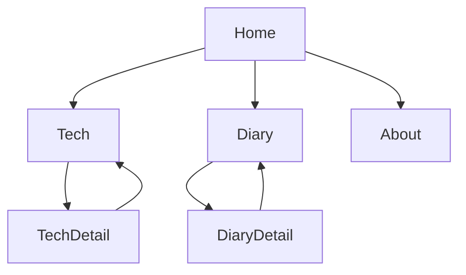
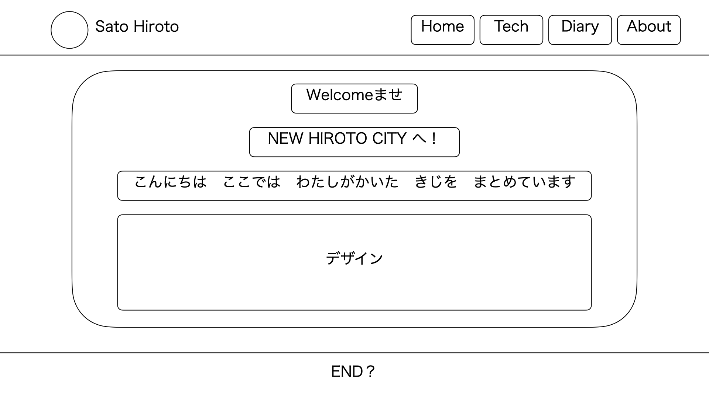
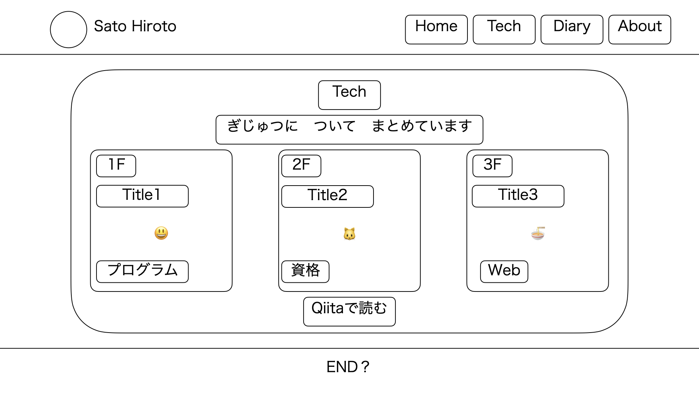
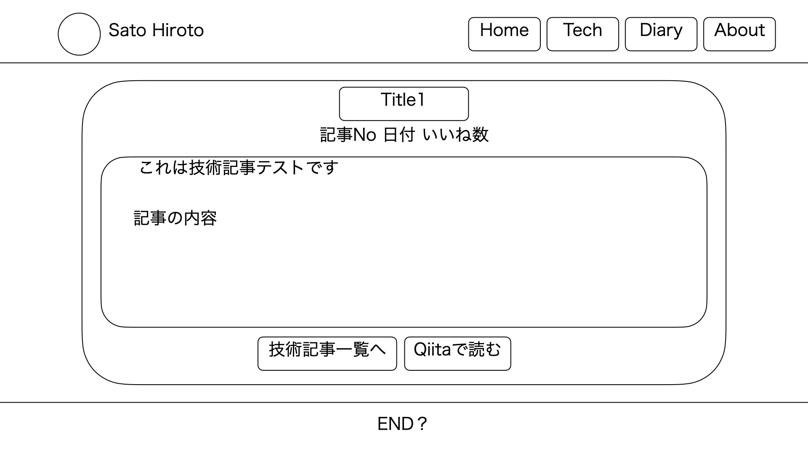
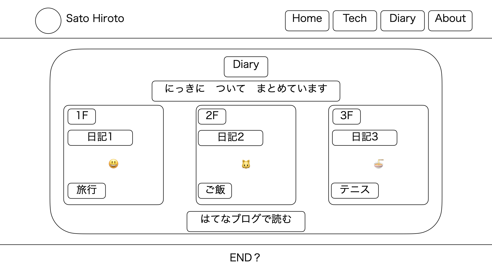
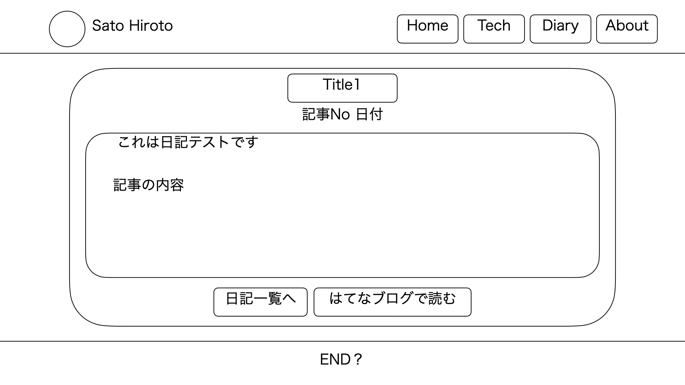
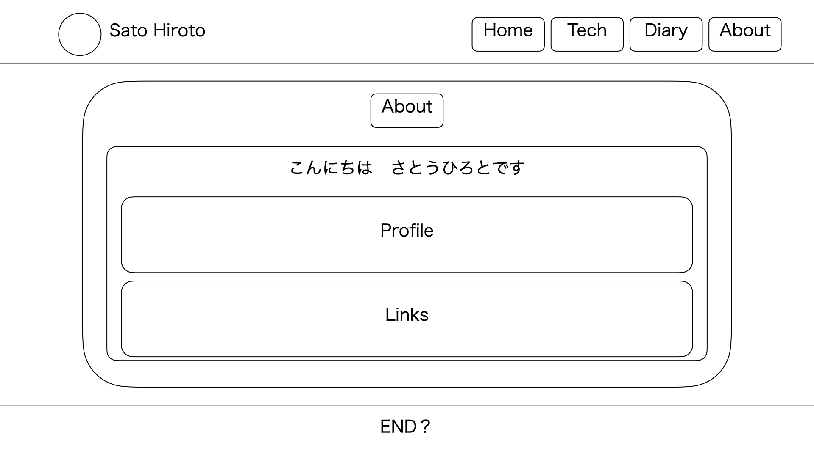
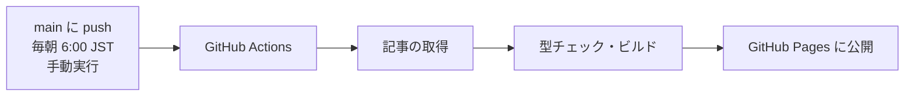

# 基本設計書
- [要件定義書](../01_要件定義書/要件定義書.md) について、システム構成・技術・デプロイ・運用を定める。
  - 詳細設計については以下を参照
    - [画面設計書](../03_詳細設計書/画面設計書.md)
    - [処理設計書](../03_詳細設計書/処理設計書.md)

## 1. システム構成
- サイトは**静的ファイルだけ**で動く。サーバー・データベース・認証は持たない
- 記事は**ビルド時に取得**してサイトに埋め込む。閲覧時に外部の API は呼ばない（記事内の画像などは元のサーバーから読み込む）
- 毎朝の自動ビルドで、新しい記事を反映する

## 2. 機能要件
[要件定義書](../01_要件定義書/要件定義書.md) の機能要件を、次の方式で実現する。

| ID | 要件 | 実現方式 | 対応画面 |
|----|------|---------|---------|
| F-01 | ヘッダーのナビゲーションでページ（Home / Tech / Diary / About）を遷移できる | 全画面共通のヘッダーにナビを置き、React Router でページを切り替える（SPA）。スマホ幅ではハンバーガーメニューにする | 全画面 |
| F-02 | Tech は Qiita、Diary ははてなブログの記事を自動で取得して表示する | ビルド時に、Qiita は API、はてなブログは Atom フィードから記事を取得し、JSON としてサイトに埋め込む（[7. データ設計](#7-データ設計)） | Tech / Diary |
| F-03 | 記事一覧は新しい順（日付の降順）で表示する | 取得した記事を投稿日時の降順に並べ、左から右・上から下へ横 3 つずつ表示する | Tech / Diary |
| F-04 | 記事カードにはタイトル・投稿日・タグ・いいねの数を出す（本文は出さない） | カードにタイトル・投稿日・タグ（はてなブログはカテゴリ）・♡ いいねの数（Qiita のみ）を出し、本文の位置にはランダムな絵文字を出す | Tech / Diary |
| F-05 | 記事カードを押下すると、サイト内の詳細ページで本文を読める。元の記事へのリンクも置く | 詳細ページ（`/tech/1F` など）で、ビルド時に保存した本文 HTML を読み込み、サイトのデザインで表示する。元の記事へのボタンを置く | TechDetail / DiaryDetail |
| F-06 | 新しい記事は、毎朝の自動ビルドでサイトに反映される | GitHub Actions を毎朝 6:00（JST）に実行し、記事の取得からデプロイまでを行う（[8. デプロイ・運用](#8-デプロイ運用)） | ― |
| F-07 | サイトを Home から開いたとき、オープニングのアニメーションを出す | Home を直接開いた・再読み込みしたときだけ、リムジンが走るアニメーションを出す。押すとすぐ閉じる | Home |

## 3. 非機能要件
| 項目 | 要件（要件定義書） | 実現方式 |
|------|------------------|---------|
| ホスティング | GitHub Pages | GitHub Actions でビルドし、GitHub Pages に公開する |
| ドメイン | 独自ドメイン（取得するまでは GitHub Pages のデフォルト） | GitHub Pages の Custom domain と DNS で設定する |
| 記事の取得 | ビルド時に取得してサイトに埋め込む | 取得スクリプトをビルドの前に自動で実行する。閲覧時は外部の API を呼ばない |
| 安全性 | 外部から取得した記事の HTML は、ビルド時にサニタイズしてから表示する | sanitize-html で、許可したタグ・属性だけを残す（スクリプト・イベント属性・`javascript:` を除く）。秘密情報（トークン）はリポジトリに置かず、GitHub の Secrets で渡す |
| レスポンシブ | PC・タブレット・スマホに対応させる | 記事カードを横 3 列（PC）→ 2 列（900px 以下）→ 1 列（600px 以下）に切り替える。680px 以下でハンバーガーメニュー |
| 運用コスト | 無料（独自ドメインを使用する場合は費用かかる） | GitHub Pages・GitHub Actions（public リポジトリ）の無料枠で運用する |

## 4. 画面遷移

| 画面 | 役割 |
|------|------|
| Home | ホーム画面 |
| Tech | 技術ブログまとめページ |
| TechDetail | 技術ブログ全文確認ページ |
| Diary | 日記ブログまとめページ |
| DiaryDetail | 日記ブログ全文確認ページ |
| About | 自己紹介ページ |

## 5. 画面イメージ
- 私が一番好きなゲームである、任天堂のゲーム「MOTHER3」に登場する「ニューポークシティ」から着想を得たデザインとした。
- 世界観を参考にしつつ、配色・レイアウト・装飾等は独自に設計する。

### Home

- デザインの箇所には以下のものを配置する
  - 前面には都会的な万物を無作為に配置する
  - 背面にはビルや観覧車などを配置する
  - [参考画像](https://cdn-ak.f.st-hatena.com/images/fotolife/g/gamestart/20170922/20170922115133.jpg)

### Tech

- メニューバーのtechボタンを押下した際に遷移する
- ブログNo、タイトル、タグを表示する
- Zennのように記事の真ん中にはランダムな絵文字を表示する
- 記事は横に3つ表示し、3n+1はn段目に表示する
  - 記事は登録日が新しい順に並べる
- Qiitaで読むボタンを押すと別タブでQiitaのマイページに遷移する

### TechDetail

- Qiitaの記事の全文（投稿日、いいね数を含む）を取得して表示する

### Diary

- メニューバーのdiaryボタンを押下した際に遷移する
- ブログNo、タイトル、タグを表示する
- Zennのように記事の真ん中にはランダムな絵文字を表示する
- 記事は横に3つ表示し、3n+1はn段目に表示する
  - 記事は登録日が新しい順に並べる
- はてなブログで読むボタンを押すと別タブではてなブログのマイページに遷移する

### DiaryDetail

- はてなブログの記事の全文（投稿日を含む）を取得して表示する

### About

- 自己紹介ページ
- 関連リンクを貼る
  - GitHub
  - Qiita
  - はてなブログ

## 6. 技術スタック（AI生成）
| 分類 | 採用技術 | 理由 |
|------|---------|------|
| 言語 | TypeScript 5 | データの型チェックで記載ミスを防ぐ |
| UI | React 18 | 部品（コンポーネント）単位で作れる |
| ルーティング | React Router 7 | ページ遷移をブラウザ側で行う（SPA） |
| ビルド | Vite 6 | 設定が少なく高速 |
| スタイル | CSS（グローバル CSS + CSS Modules） | 追加ライブラリ不要。部品ごとにスコープを分けられる |
| 記事の取得 | Node.js 20 のスクリプト、fast-xml-parser | Qiita API・はてなブログの Atom フィードを読む |
| サニタイズ | sanitize-html 2.17.5 | 外部から取得した HTML を安全にする（2.17.6 以降は Node 20.19 以上が必要なため固定） |
| ホスティング | GitHub Pages | 無料。GitHub Actions で自動デプロイ |
| CI/CD | GitHub Actions | push・毎朝・手動でビルドしてデプロイ |

## ７. デプロイ・運用
### 7.1 デプロイの流れ

| きっかけ | 用途 |
|---------|------|
| `main` ブランチへの push | ソースを変更したとき |
| 毎朝 6:00（JST）の定期実行 | 新しい記事を反映する |
| Actions タブの「Run workflow」 | 記事を書いてすぐ反映したいとき |

### 7.2 日々の運用
| やりたいこと | 方法 |
|-------------|------|
| 技術記事・日記を追加する | Qiita・はてなブログに記事を書く（次のビルドで反映） |
| 技術記事・日記の変更をすぐに反映したい | Actions タブの「Run workflow」を押す |
| 自己紹介を詳細にする | [About.tsx](../../dev/src/app/pages/About.tsx) を編集して push する |

ソースを変更したら、`dev/` で `npm run build` が通ることを確認してから push する。

### 7.3 運用上の注意
- リポジトリに 60 日間更新がないと、GitHub が定期実行を止める。止まった場合は Actions タブから再度有効にする
- 開発用ツールの脆弱性は `npm audit` で確認し、必要に応じて更新する