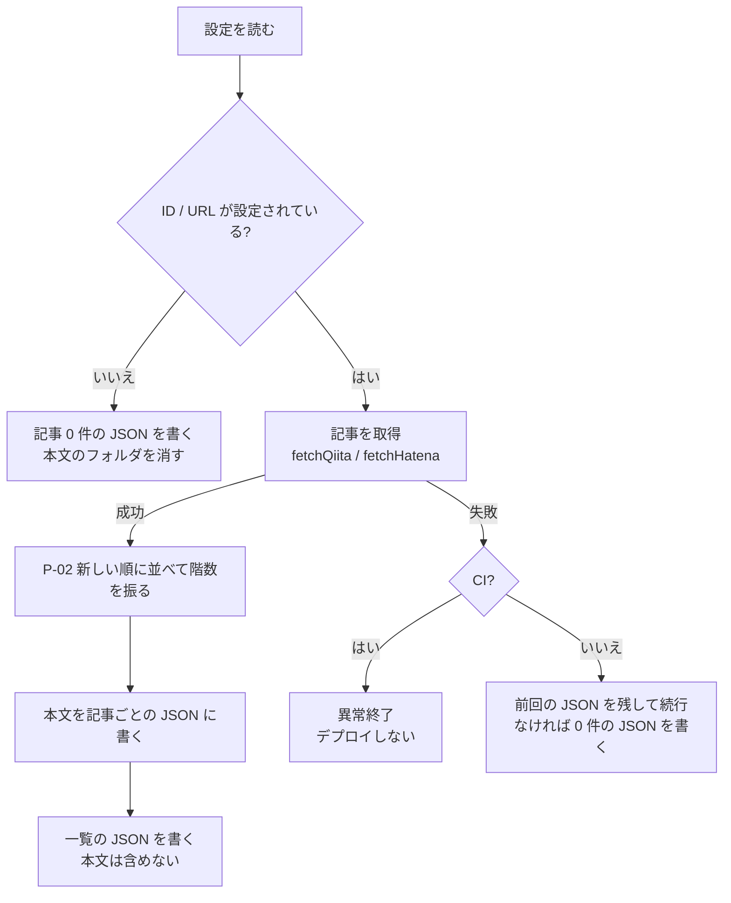
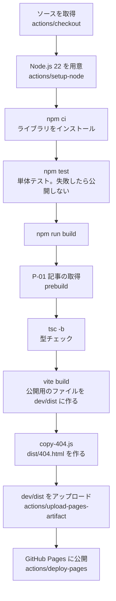
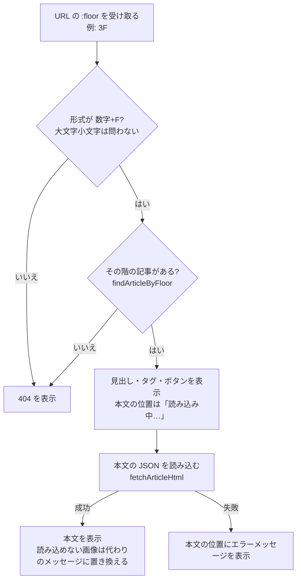

# 処理設計書

[基本設計書](../02_基本設計書/基本設計書.md) の機能要件を実現する処理（記事の取得・階数・サニタイズ・ビルドとデプロイ・画面側の処理）と、データ形式・エラー処理を定める。<br>
画面の構成と見た目は [画面設計書](画面設計書.md) を参照。

---

## 0. 本書について

### 0.1 位置づけ（リバースエンジニアリング）
本書は、**先に作った実装（`dev/` のソース）を読み解いて、設計書の形に書き起こしたもの**である（リバースエンジニアリング）。<br>
私に実装の経験がないため、AIと対話しながら実装を進め、完成したソースから逆算して記録した。

各処理には、次を併記する。

| 併記する内容 | 目的 |
|-------------|------|
| 対応する要件（F-01 など） | 要件定義書・基本設計書とのつながりを追えるようにする |
| 入力・出力 | 何を受け取り、何を作るのかを明確にする |
| 実装しているファイル・関数 | 変更したいときに、どこを見ればよいか分かるようにする |
| しくみの補足 | 実装経験がなくても、なぜその処理が必要か・どう動くかを理解できるようにする |

設計書と実装が食い違った場合は、**実装（ソース）が正**とし、本書を実装に合わせて直す。

### 0.2 処理が動くタイミング
処理は、**ビルド時**（GitHub Actions や手元の PC でサイトを作るとき）と、**閲覧時**（訪問者のブラウザで画面を表示するとき）の 2 つに分かれる。

```mermaid
graph LR
  subgraph ビルド時（GitHub Actions・手元の PC）
    P01[P-01 記事の取得] --> P02[P-02 階数の付与]
    P01 --> P03[P-03 本文のサニタイズ]
    P02 --> Data[(記事データ JSON)]
    P03 --> Data
    Data --> P04[P-04 ビルド・デプロイ]
  end
  P04 --> Site[公開されたサイト<br/>GitHub Pages]
  subgraph 閲覧時（訪問者のブラウザ）
    Site --> P05[P-05 画面の切り替え]
    P05 --> P06[P-06 記事一覧の表示]
    P05 --> P07[P-07 記事詳細の表示]
    P05 --> P08[P-08 オープニングの表示判定]
    P05 --> P09[P-09 タブのタイトル]
    P06 --> P10[P-10 カードの絵文字]
  end
```

> **しくみの補足**: このサイトにはサーバーがない。外部サービス（Qiita・はてなブログ）から記事を取ってくる処理は、ビルド時に 1 回だけ行い、結果をファイル（JSON）にしてサイトに同梱する。訪問者のブラウザは、そのファイルを読んで画面を作るだけなので、外部サービスにはアクセスしない。

### 0.3 ソースの場所
| 場所 | 中身 | 動くタイミング |
|------|------|--------------|
| `dev/scripts/` | 記事の取得・サニタイズなど、ビルド時に動くスクリプト（Node.js） | ビルド時 |
| `dev/src/app/` | 画面のソース（React + TypeScript） | 閲覧時 |
| `.github/workflows/deploy.yml` | ビルドとデプロイの手順（GitHub Actions） | ビルド時 |
| `dev/feeds.config.json` | 記事の取得元の設定 | ビルド時 |

### 0.4 用語
| 用語 | 意味 |
|------|------|
| ビルド | ソースから、公開用のファイル（HTML・JS・CSS）を作ること。`npm run build` で行う |
| API | 外部サービスがデータを渡してくれる窓口。Qiita は記事の一覧を JSON で返す API を公開している |
| フィード（Atom） | ブログの新着記事を、決まった形式（XML）で配信するもの。はてなブログは最新 30 件を配信している |
| サイトマップ | サイトのページ一覧を検索エンジン向けに書いたファイル。はてなブログでは月ごとの記事の一覧がある |
| JSON | データを `{ "title": "..." }` のような形で書くファイル形式 |
| HTML | 画面の中身を `<h2>見出し</h2>` のようなタグで書く形式。記事の本文は HTML で受け取る |
| サニタイズ | 外部から受け取った HTML から、危険なもの（勝手に動くプログラムなど）を取り除くこと |
| GitHub Actions | GitHub 上で、決まった手順を自動で実行する仕組み。ここではビルドと公開を自動化している |
| ルーティング | URL を見て、どの画面を出すかを決めること |

---

## 1. 処理一覧

| ID | 処理 | 動くタイミング | 対応する要件 | 実装 |
|----|------|--------------|------------|------|
| P-01 | 記事の取得 | ビルド時 | F-02、F-06 | `dev/scripts/fetch-feeds.mjs`、`dev/scripts/lib/` |
| P-02 | 階数の付与 | ビルド時 | F-03、F-05（URL） | `dev/scripts/lib/floors.mjs` の `assignFloors()` |
| P-03 | 本文のサニタイズ | ビルド時 | 非機能要件「安全性」 | `dev/scripts/sanitize-article.mjs` |
| P-04 | ビルド・デプロイ | ビルド時 | F-06 | `.github/workflows/deploy.yml`、`dev/package.json` |
| P-05 | 画面の切り替え（ルーティング） | 閲覧時 | F-01、F-05 | `dev/src/app/App.tsx`、`main.tsx` |
| P-06 | 記事一覧の表示 | 閲覧時 | F-02、F-03、F-04 | `pages/ArticleListPage.tsx`、`components/ArticleList.tsx` |
| P-07 | 記事詳細の表示 | 閲覧時 | F-05 | `pages/ArticleDetail.tsx` |
| P-08 | オープニングの表示判定 | 閲覧時 | F-07 | `pages/Home.tsx`、`components/Splash.tsx` |
| P-09 | タブのタイトル | 閲覧時 | ― | `components/Layout.tsx` |
| P-10 | カードの絵文字 | 閲覧時 | F-04 | `data/articles.ts` の `articleEmoji()` |

閲覧時の処理のパスは `dev/src/app/` からの相対パスで書く。

---

## 2. ビルド時の処理

### P-01 記事の取得
| 項目 | 内容 |
|------|------|
| 対応する要件 | F-02（Tech は Qiita、Diary ははてなブログの記事を自動で取得）、F-06（毎朝反映） |
| 入力 | `dev/feeds.config.json`、環境変数、Qiita API・はてなブログのフィードとサイトマップ |
| 出力 | 一覧の JSON（`dev/src/app/data/generated/{qiita,hatena}.json`）、本文の JSON（`dev/src/public/articles/{qiita,hatena}/<slug>.json`） |
| 実装 | `dev/scripts/fetch-feeds.mjs`（入口）。中身は `dev/scripts/lib/` に分けている: `sources.mjs`（取得）、`text.mjs`（文字の整形）、`update.mjs`（保存）、`floors.mjs`（階数） |
| 実行のタイミング | `npm run dev` / `build` / `typecheck` の直前に自動で実行（`package.json` の `predev` / `prebuild` / `pretypecheck`）。手動では `npm run fetch-feeds` |

#### 設定（`dev/feeds.config.json`）
```json
{
  "qiita": { "userId": "hirotoro", "maxItems": 100 },
  "hatena": { "blogUrl": "https://hirotoro.hatenablog.com/", "category": "" }
}
```

| 項目 | 内容 |
|------|------|
| `qiita.userId` | Qiita のユーザー ID（`https://qiita.com/<ここ>`） |
| `qiita.maxItems` | 取得する最大件数（100 件ずつページ送りして取得） |
| `hatena.blogUrl` | はてなブログの URL |
| `hatena.category` | 指定するとそのカテゴリの記事だけを取得。空なら全記事 |

| 環境変数 | 内容 |
|---------|------|
| `QIITA_USER_ID` / `HATENA_BLOG_URL` / `HATENA_CATEGORY` | あれば設定ファイルより優先する |
| `QIITA_TOKEN` | 任意。Qiita の読み取り専用トークン（GitHub の Secrets で渡す）。設定すると Qiita の利用回数の上限が 1 時間 60 回 → 1,000 回になる |
| `CI` | `true` のとき、取得に失敗したら異常終了する（GitHub Actions では自動的に `true`） |

#### 処理の流れ（`update()`。Qiita・はてなブログそれぞれで実行）


#### 取得元ごとの処理
| 取得元 | 関数 | 取得するもの | 取り出す内容 |
|--------|------|------------|------------|
| Qiita | `fetchQiita()` | `GET https://qiita.com/api/v2/users/:user_id/items?page=N&per_page=100` | タイトル・URL・投稿日時・タグ・いいねの数・本文（`rendered_body`）。記事の総数はレスポンスヘッダー `Total-Count` |
| はてなブログ | `fetchHatena()` | `GET https://<blog>/feed`（カテゴリ指定時は `/feed/category/<カテゴリ>`） | タイトル・URL・投稿日時・カテゴリ・本文（`<content>`）。記事の総数は `countHatenaEntries()` でサイトマップから数える |

| 補助の関数 | 役割 |
|-----------|------|
| `countHatenaEntries()` | サイトマップ（`/sitemap_index.xml` → 月ごとの `sitemap_periodical.xml`）の記事数を合計する |
| `text()` / `decodeXml()` | XML の値を取り出し、`&lt;` などの記号（エンティティ）を元の文字に戻す |
| `markdownToText()` / `htmlToText()` / `truncate()` | 概要（120 文字）を作る（今の画面では使っていない） |
| `write()` / `exists()` | JSON ファイルの書き込み・存在確認 |

> **しくみの補足**: はてなブログの本文は、フィードの中に記号（`&lt;` など）で書かれた HTML として入っている。XML を読むライブラリ（fast-xml-parser）にそのまま任せると、記号が多すぎて安全のための上限に引っかかるため、ライブラリでは記号を戻さず、`decodeXml()` で自前で戻している。

> **しくみの補足**: 一覧の JSON と本文の JSON を分けているのは、表示を速くするため。一覧（タイトルなど）はサイトの JS に埋め込んで即表示し、重い本文は詳細画面を開いたときだけ読み込む。

### P-02 階数の付与
| 項目 | 内容 |
|------|------|
| 対応する要件 | F-03（新しい順）、F-05（詳細画面の URL `/tech/1F`） |
| 入力 | P-01 で取得した記事と、記事の総数 |
| 出力 | 各記事の `floor`（階数）。並び順は新しい順 |
| 実装 | `dev/scripts/lib/floors.mjs` の `assignFloors()`（`dev/scripts/lib/update.mjs` の `update()` から呼ぶ） |

**一番古い記事を 1F とし、新しい記事ほど上の階にする**（最新の記事の階数 = 記事の総数）。新しい記事を書いても、既存の記事の階数（= URL）は変わらない。

```
top = max(記事の総数, 取得した件数)
取得した記事を投稿日時の新しい順に並べ、i 番目（0 始まり）の記事に floor = top − i を振る
```

例: 総数 409 件、最新 100 件を取得 → 新しい順に 409F, 408F, …, 310F

| ケース | 扱い |
|--------|------|
| 総数が取れなかった / 取得した件数より少ない | 取得した件数を総数とみなす |
| はてなブログで `category` を指定している | サイトマップの総数は全カテゴリの数になるため使わず、取得した件数で数える。カテゴリの記事が 30 件を超えると階数がずれる |
| 過去の記事を削除した | それより新しい記事の階数が 1 つずつ下がる |

> **しくみの補足**: 取得できるのは最新の一部（Qiita は最大 100 件、はてなブログは 30 件）だけなので、「古い順に 1, 2, 3…」と数えると、取得範囲から古い記事が外れたときに番号がずれてしまう。そこで、記事の総数から逆算して「新しい順に 総数, 総数−1, …」と振ることで、番号が変わらないようにしている。

### P-03 本文のサニタイズ
| 項目 | 内容 |
|------|------|
| 対応する要件 | 非機能要件「安全性」（外部から取得した記事の HTML は、ビルド時にサニタイズしてから表示する） |
| 入力 | 記事の本文 HTML、元のサイトの URL（相対リンクを直すため） |
| 出力 | サニタイズ済みの本文 HTML |
| 実装 | `dev/scripts/sanitize-article.mjs` の `sanitizeArticleHtml()`（sanitize-html を使用） |

許可したタグ・属性だけを残し、それ以外は取り除く。

| 対象 | 扱い |
|------|------|
| `<script>`、`onclick` などのイベント属性、`javascript:` のリンク | 削除 |
| 見出し・段落・リスト・表・画像・コードなど | 残す（`class` / `id` / `data-lang` も残して見た目に使う） |
| `style` 属性 | 表の文字揃え（`text-align`）だけ残す |
| iframe（YouTube、Google マップ） | 残す（`loading="lazy"` を付ける） |
| iframe（Qiita のリンクカード） | リンク先へのリンクに置き換える（`replaceUnsupportedIframes()`） |
| iframe（Qiita の Mermaid の図） | 図の元になるコードを、コードブロックで表示する |
| iframe（はてなブログカードなど、その他） | 埋め込み先へのリンクに置き換える |
| 相対リンク・画像（`/user` など） | 元のサイト基準の URL にする（`absolutize()`。Qiita は `https://qiita.com`、はてなブログはブログの URL） |
| 外部リンク | 別タブで開く（`target="_blank" rel="noopener noreferrer"`） |
| 画像 | `loading="lazy"`（画面に入ったときに読み込む）を付ける |
| はてなキーワードの自動リンク | リンクを外して、ただの文字にする |
| Qiita の見出しのリンクアイコンと、中身のないリンク | 削除 |

| 補助の関数 | 役割 |
|-----------|------|
| `replaceUnsupportedIframes()` | 許可していない iframe を、内容に応じてリンクやコードブロックに置き換える |
| `attr()` / `decodeHtmlAttr()` | iframe の属性（`src`・`data-content` など）の値を取り出す |
| `absolutize()` | 相対 URL を絶対 URL にする |
| `safeJson()` / `safeDecodeUri()` | 壊れたデータでもエラーで止まらないように読み取る |
| `escapeHtml()` | 置き換えた文字列に記号が含まれても、HTML として誤解されないようにする |

> **しくみの補足**: 記事の HTML には、元のサービスの都合で埋め込み（iframe）やスクリプトが入っていることがある。そのまま自分のサイトで表示すると、意図しないプログラムが動く危険があるため、ビルド時に「安全と分かっているもの」だけを残している。画面側では、サニタイズ済みの HTML をそのまま差し込んで表示する（React の `dangerouslySetInnerHTML`）。

sanitize-html は、脆弱性が修正された 2.18.1 に固定している（2.18 以降は Node.js 22.12 以上が必要なため、手元・GitHub Actions とも Node.js 22 を使う）。

### P-04 ビルド・デプロイ
| 項目 | 内容 |
|------|------|
| 対応する要件 | F-06（毎朝の自動ビルドで反映） |
| 入力 | `main` ブランチのソース |
| 出力 | GitHub Pages に公開されたサイト |
| 実装 | `.github/workflows/deploy.yml`、`dev/package.json` の `build` |

#### きっかけ
| きっかけ | 設定（`deploy.yml`） |
|---------|---------------------|
| `main` ブランチへの push | `on: push` |
| 毎朝 6:00（JST） | `on: schedule`（`cron: '0 21 * * *'`。GitHub の時刻は UTC なので、UTC 21:00 = JST 6:00） |
| Actions タブの「Run workflow」 | `on: workflow_dispatch` |

#### 手順


どこかの手順で失敗したら、そこで止まり公開しない（公開中のサイトは前回のまま）。

> **しくみの補足（404.html）**: GitHub Pages は、`/tech/1F` のような URL に対応するファイルがないと 404.html を返す。そこで、ビルドの最後に index.html を 404.html としてコピーしておく（`copy-404.js`）。すると、どの URL でもサイト本体が読み込まれ、画面側（P-05）が URL を見て正しい画面を出す。

> **しくみの補足（公開パス）**: リポジトリ名が `<ユーザー名>.github.io` 以外で独自ドメインを使わない場合、サイトは `https://<ユーザー名>.github.io/<リポジトリ名>/` で公開される。そのときは `deploy.yml` の `VITE_BASE` に `/<リポジトリ名>/` を設定し、画像などのパスを合わせる。

---

## 3. 閲覧時の処理

### P-05 画面の切り替え（ルーティング）
| 項目 | 内容 |
|------|------|
| 対応する要件 | F-01（ナビで遷移）、F-05（詳細画面） |
| 入力 | ブラウザの URL |
| 出力 | URL に対応する画面 |
| 実装 | `App.tsx`（URL と画面の対応表）、`main.tsx`（入り口）、`components/Header.tsx`（ナビ）、`components/Layout.tsx` |

| URL | 画面（基本設計書） | 部品 |
|-----|------------------|------|
| `/` | Home | `Home` |
| `/tech` | Tech | `ArticleListPage`（qiita） |
| `/tech/:floor` | TechDetail | `ArticleDetail`（qiita） |
| `/diary` | Diary | `ArticleListPage`（hatena） |
| `/diary/:floor` | DiaryDetail | `ArticleDetail`（hatena） |
| `/about` | About | `About` |
| `/travel` 以下 | （旧 URL） | `/diary` に転送 |
| それ以外 | 404 | `NotFound` |

- 画面を移動したら、先頭までスクロールする（`Layout.tsx`）
- ナビの項目は、今の URL に応じて選択中の見た目にする（React Router の `NavLink`）

> **しくみの補足**: React Router を使い、URL が変わっても HTML を読み直さずに、ブラウザの中で画面の部品を差し替えている（SPA）。`:floor` の部分は可変で、`/tech/3F` なら `floor = "3F"` として P-07 に渡す。

### P-06 記事一覧の表示
| 項目 | 内容 |
|------|------|
| 対応する要件 | F-02（取得した記事を表示）、F-03（新しい順）、F-04（カードの内容） |
| 入力 | 一覧の JSON（ビルド時にサイトに埋め込み済み）、`SOURCE_PAGES` |
| 出力 | Tech / Diary の画面 |
| 実装 | `pages/ArticleListPage.tsx`、`components/ArticleList.tsx`、`components/ArticleCard.tsx`、`data/articles.ts` |

1. `ArticleListPage` が「qiita か hatena か」を受け取り、`SOURCE_PAGES` から見出し・説明文・色を取り出す
2. `ArticleList` が一覧の JSON の記事を、並び順（新しい順）のまま `ArticleCard` にして並べる。記事が 0 件なら `FeedEmpty`（「まだ記事がありません」）
3. `ArticleCard` が 1 件ずつ、階数・投稿日・いいね・タイトル・絵文字・タグを表示する

#### Tech と Diary の違い（`data/articles.ts` の `SOURCE_PAGES`）
| 項目 | qiita（Tech） | hatena（Diary） |
|------|------|-------|
| `basePath` | `/tech` | `/diary` |
| `kicker` | ▶ 技術 | ▶ 日記 |
| `title` / `tone` | Tech / cyan（水色） | Diary / pink（ピンク） |
| `lead` | ぎじゅつに　ついて　まとめています | にっきを　まとめています |
| `serviceName` | Qiita | はてなブログ |
| `configKey` | qiita.userId | hatena.blogUrl |

#### 表示用の関数（`data/articles.ts`）
| 関数 | 入力 → 出力 | 例 |
|------|------------|-----|
| `floorLabel()` | 階数 → 表記 | `3` → `"3F"` |
| `articlePath()` | 記事 → 詳細画面の URL | → `"/tech/3F"` |
| `formatDate()` | 日時 → 表示用の日付 | `"2026-10-25T02:38:19+09:00"` → `"2026.10.25"` / `"2026年10月25日"` |
| `likesLabel()` | 記事 → いいねの表記 | `likes: 3` → `"♡ 3"`、はてなブログ → なし |
| `articleMeta()` | 記事 → カードの小さな情報 | `"2026.10.25　♡ 3"` |
| `articleEmoji()` | 記事 → 絵文字（P-10） | `"🐸"` |

> **しくみの補足**: 一覧のデータはビルド時にサイトの JS に埋め込まれているので、画面を開いた瞬間に表示でき、通信を待たない。並び替え（新しい順）も P-02 で済ませてあるので、画面側では並べ替えない。

### P-07 記事詳細の表示
| 項目 | 内容 |
|------|------|
| 対応する要件 | F-05（サイト内の詳細画面で本文を読める。元の記事へのリンクも置く） |
| 入力 | URL の階数（`:floor`）、一覧の JSON、本文の JSON |
| 出力 | TechDetail / DiaryDetail の画面 |
| 実装 | `pages/ArticleDetail.tsx`、`data/articles.ts` の `findArticleByFloor()`・`fetchArticleHtml()` |



| 処理 | 内容 |
|------|------|
| 元の記事を正規の URL として示す | `<link rel="canonical">` に元の記事の URL を設定し、画面を離れたら取り除く（`useCanonical()`）。同じ記事が 2 か所にあっても、検索エンジンに重複と判断されないようにする |
| 記事が変わったら作り直す | 記事ごとに部品を作り直し（`key`）、前の記事の本文が一瞬残らないようにする |
| 取得元ごとの文言 | `SOURCES`（ボタン・小見出し・注記の文言）で切り替える |

> **しくみの補足**: 本文は、詳細画面を開いたときに `public/articles/<qiita|hatena>/<slug>.json` を読み込む。このファイルはサイトと一緒に GitHub Pages に置かれているので、外部サービスにはアクセスしない。

### P-08 オープニングの表示判定
| 項目 | 内容 |
|------|------|
| 対応する要件 | F-07（サイトを Home から開いたとき、オープニングのアニメーションを出す） |
| 入力 | ブラウザの履歴の位置、このタブで Home を表示したことがあるか |
| 出力 | オープニングを出す / 出さない |
| 実装 | `pages/Home.tsx`（`splashPending`・`isFirstPageOfTab()`）、`components/Splash.tsx` |

```
出す = まだこのタブで一度も Home を表示していない（splashPending）
      かつ このタブで最初に開いた画面である（React Router の履歴の位置 history.state.idx が 0）
```

| 開き方 | 出すか |
|--------|-------|
| Home の URL を直接開いた・再読み込みした | 出す |
| ナビで Home に戻ってきた | 出さない |
| Tech などを直接開き、そのあと Home に移動した | 出さない |

#### 閉じるタイミング（`Splash.tsx`）
| きっかけ | 内容 |
|---------|------|
| アニメーションが終わった | 幕が消え終わったら（`animationend`）取り除く。中のリムジンのアニメーション終了では閉じない |
| 幕を押した | すぐに取り除く |
| 4.2 秒たった | 上の 2 つが起きなかった場合の保険（タブが裏にあってアニメーションが進まない場合など） |

> **しくみの補足**: React の開発モード（StrictMode）では、部品の初期化が確認のために 2 回行われることがある。そのため、初期化では「出すかどうか」を読むだけにし、「もう表示した」という記録（`splashPending = false`）は、表示が終わったあとの処理（`useEffect`）で行っている。こうしないと、開発中にオープニングが出たり出なかったりする。

### P-09 タブのタイトル
| 項目 | 内容 |
|------|------|
| 入力 | URL |
| 出力 | ブラウザのタブのタイトル（`document.title`） |
| 実装 | `components/Layout.tsx`（`pageName()`、`SITE_NAME`） |

URL の最初の部分から画面名を決め、「画面名　|　SatoHiroto」にする。

| URL | タイトル |
|-----|---------|
| `/` | Home　\|　SatoHiroto |
| `/tech`、`/tech/*` | Tech　\|　SatoHiroto |
| `/diary`、`/diary/*` | Diary　\|　SatoHiroto |
| `/about` | About　\|　SatoHiroto |
| それ以外 | 404　\|　SatoHiroto |

### P-10 カードの絵文字
| 項目 | 内容 |
|------|------|
| 対応する要件 | F-04（本文は出さない。かわりに絵文字を出す） |
| 入力 | 記事の ID（`slug`） |
| 出力 | 絵文字 1 つ |
| 実装 | `data/articles.ts` の `articleEmoji()`、`CARD_EMOJIS` |

記事の ID の文字から数値（ハッシュ値）を計算し、20 種類の絵文字（🐸🚀🎡🍜🦝📷🗼🎠🎈🍙🌙⭐🎮🛸🍡🎁🌸🍩🎪🧃）から 1 つ選ぶ。

> **しくみの補足**: 毎回ランダムに選ぶと、画面を開くたびに絵文字が変わってしまう。記事の ID から計算すると、記事ごとにばらばらに見えつつ、同じ記事はいつも同じ絵文字になる。

---

## 4. データ形式

基本設計書の範囲外のため、データの詳細は本書で定める。データベースは持たず、すべてファイルで管理する。

### 4.1 データの一覧
| データ | 置き場所 | 作られ方 | git 管理 |
|--------|---------|---------|---------|
| 記事の一覧 | `dev/src/app/data/generated/{qiita,hatena}.json` | P-01 で自動生成。サイトの JS に埋め込む | 対象外 |
| 記事の本文 | `dev/src/public/articles/{qiita,hatena}/<slug>.json` | P-01・P-03 で自動生成。詳細画面を開いたときに読み込む | 対象外 |
| 取得元の設定 | `dev/feeds.config.json` | 手で編集 | 対象 |
| 自己紹介・プロフィール | `dev/src/app/pages/About.tsx`（`PROFILE`） | 手で編集 | 対象 |
| 画像 | `dev/src/public/*.png` | 手で用意（メタデータは削除） | 対象 |

自動生成するファイルは毎回作り直すため、git では管理しない（`.gitignore` で除外）。

### 4.2 記事の一覧（`generated/*.json`）
型の定義は `data/articles.ts`。

```ts
type Feed = {
  configured: boolean;       // 設定ファイルに ID / URL があるか
  profileUrl: string | null; // 「Qiitaで読む」「はてなブログで読む」のリンク先
  fetchedAt: string | null;  // 取得日時（ISO 8601）
  articles: Article[];       // 新しい順（上の階から）
};

type Article = {
  slug: string;              // 取得元での記事 ID。本文ファイル名に使う
  floor: number;             // 階数（一番古い記事 = 1）。URL /tech/1F に使う
  title: string;             // タイトル
  url: string;               // 元の記事の URL
  publishedAt: string;       // 投稿日時（ISO 8601）
  tags: string[];            // Qiita のタグ / はてなブログのカテゴリ
  summary: string;           // 概要（120 文字まで。今の画面では使っていない）
  thumbnail: string | null;  // はてなブログのアイキャッチ画像（今の画面では使っていない）
  likes: number | null;      // Qiita のいいね（LGTM）の数。はてなブログは null
};
```

### 4.3 記事の本文（`articles/<qiita|hatena>/<slug>.json`）
```json
{ "html": "<h2>見出し</h2><p>本文…</p>" }
```
P-03 でサニタイズ済みの HTML。

---

## 5. エラー処理

### 5.1 基本方針
- **壊れたサイトは公開しない**: ビルド時にエラーが起きたら、公開を止める。公開中のサイトは前回のまま残る
- **閲覧者には、画面が壊れない形で知らせる**: 読み込めない部分だけをメッセージに置き換え、ほかの部分は表示する
- **手元の開発は止めない**: 手元では、記事の取得に失敗しても前回のデータで作業を続けられるようにする

### 5.2 エラーごとの扱い
| 発生箇所 | エラー | 扱い | 実装 |
|---------|-------|------|------|
| ビルド（GitHub Actions） | 記事の取得に失敗（外部サービスの障害・仕様変更など） | 異常終了し、公開しない | `fetch-feeds.mjs`（`CI=true` のとき） |
| ビルド（GitHub Actions） | 型チェック・ビルドの失敗 | 同上 | `deploy.yml` |
| ビルド（手元） | 記事の取得に失敗 | 前回のデータを残して続行。前回のデータもなければ 0 件 | `scripts/lib/update.mjs` の `update()` |
| ビルド（共通） | 取得元が未設定 | 記事 0 件として続行（開発中は画面に設定方法を出す） | `update()`、`FeedEmpty.tsx` |
| ビルド（共通） | はてなブログの記事の総数を数えられない | 警告を出し、取得した件数で階数を振る | `countHatenaEntries()` |
| ビルド（共通） | 記事の HTML の埋め込みの情報が壊れている | エラーで止めずに続行する（リンクカードは取り除き、Mermaid の図は中身が空のコードブロックになる） | `sanitize-article.mjs`（`safeJson()`・`safeDecodeUri()`） |
| 閲覧時 | 存在しない URL・存在しない階数 | 404 画面を表示 | `App.tsx`、`ArticleDetail.tsx` |
| 閲覧時 | 記事の本文を読み込めない | 本文の位置にエラーメッセージを表示 | `ArticleDetail.tsx` |
| 閲覧時 | 記事内の画像を読み込めない | 「画像を表示できませんでした」に置き換える | `ArticleDetail.tsx` |
| 閲覧時 | 記事がない | 「まだ記事がありません。」を表示 | `FeedEmpty.tsx` |
| 閲覧時 | オープニングが終わらない | 4.2 秒で取り除く | `Splash.tsx` |

---

## 6. 定数・設定値の一覧

変更したいときに見る場所。

| 値 | 内容 | 場所 |
|----|------|------|
| 記事の取得元 | Qiita のユーザー ID、はてなブログの URL・カテゴリ、Qiita の最大取得件数（100） | `dev/feeds.config.json` |
| 概要の長さ | 120 文字（今の画面では使っていない） | `scripts/lib/text.mjs` の `SUMMARY_LENGTH` |
| 埋め込みを許可するサービス | YouTube・Google マップ | `sanitize-article.mjs` の `IFRAME_HOSTS` |
| Tech・Diary の文言・色 | 小見出し・看板・説明文・サービス名 | `data/articles.ts` の `SOURCE_PAGES` |
| カードの絵文字 | 20 種類 | `data/articles.ts` の `CARD_EMOJIS` |
| 詳細画面の文言 | ボタン・小見出し・注記 | `pages/ArticleDetail.tsx` の `SOURCES` |
| タブのタイトルの名前 | `SatoHiroto` | `components/Layout.tsx` の `SITE_NAME` |
| ナビの項目 | Home / Tech / Diary / About | `components/Header.tsx` の `NAV_ITEMS` |
| プロフィールの表 | 拠点・趣味・すきな〇〇・資格 | `pages/About.tsx` の `PROFILE` |
| オープニングの保険の時間 | 4.2 秒 | `components/Splash.tsx` の `FALLBACK_MS` |
| フッターのカエルの数 | 100 匹 | `components/FrogParade.tsx` の `FROG_COUNT` |
| 自動ビルドの時刻 | 毎朝 6:00（JST） | `.github/workflows/deploy.yml` の `cron` |
